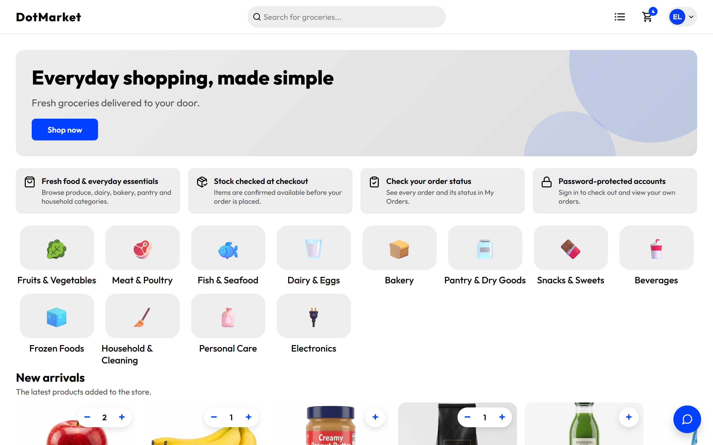
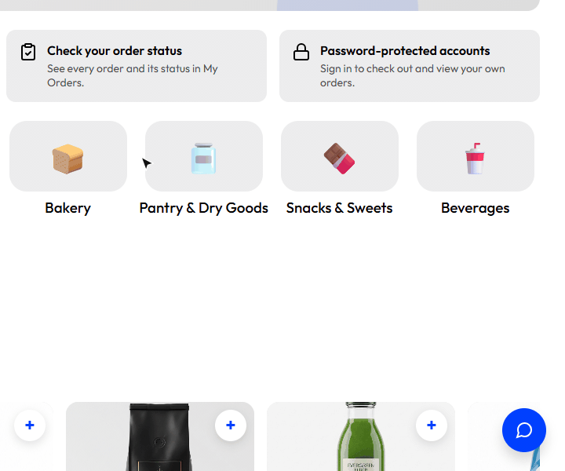
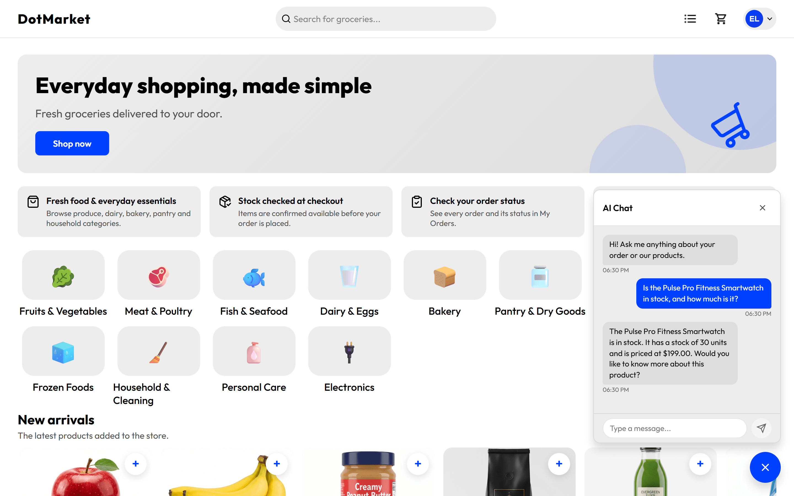
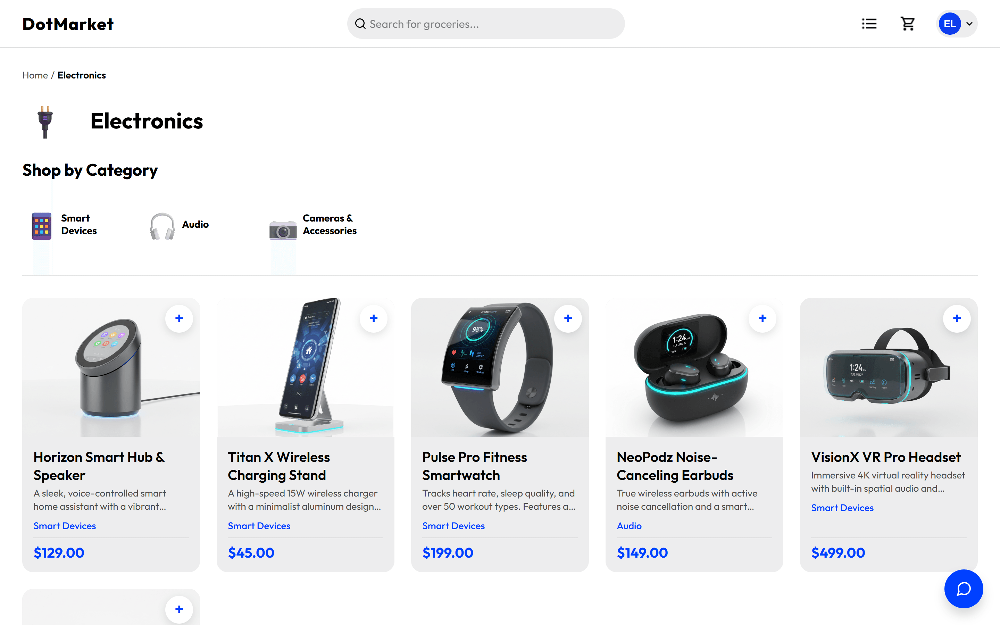
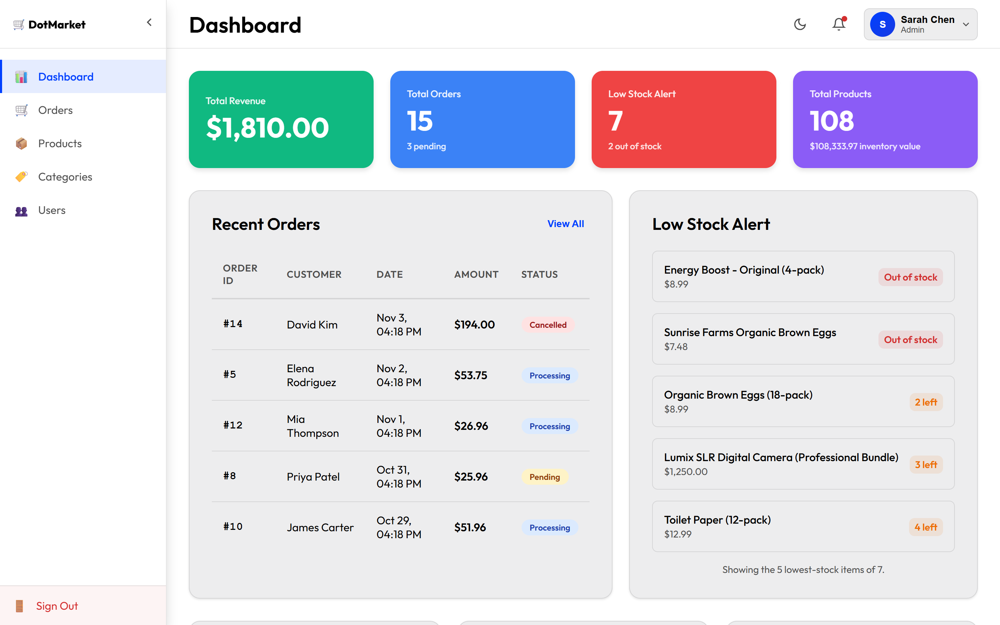
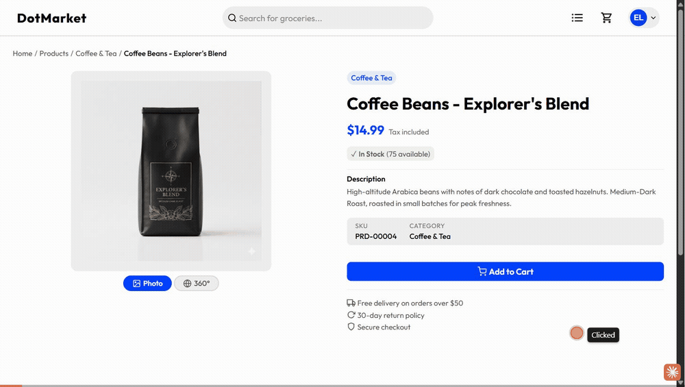
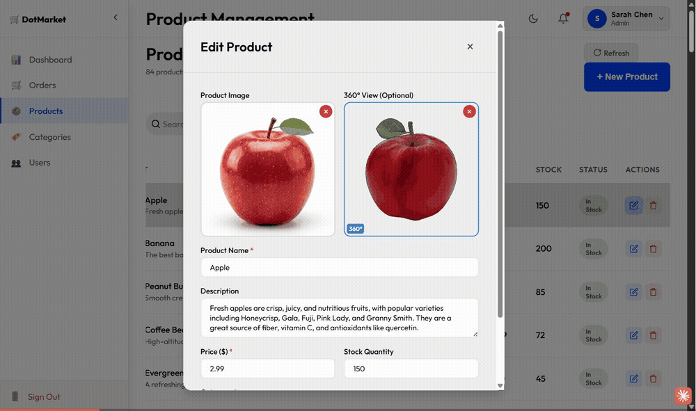
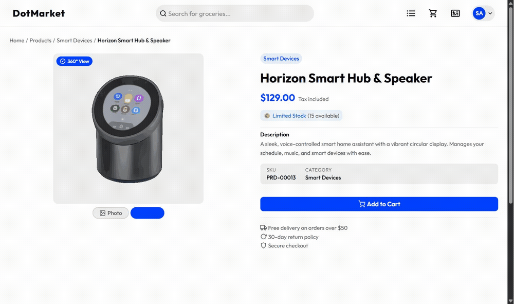
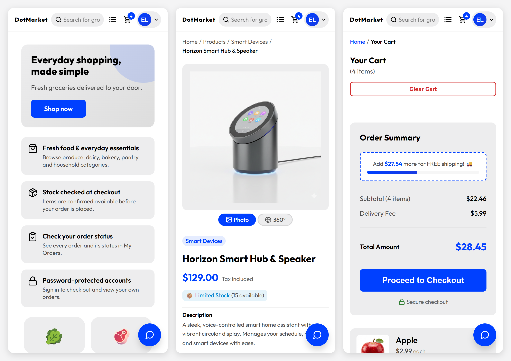
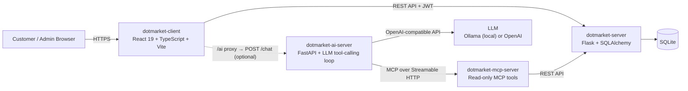

# 🛒 Dotmarket

**A full-stack supermarket e-commerce app** — a customer storefront, a complete admin/manager back office, and an **AI shopping assistant** that answers from the live catalog through MCP tool calls. Built to demonstrate production-style architecture across four independently deployable services.

  

---

## 📸 Preview

  
   <b>Storefront</b> — home page, logged in

**🤖 Ask the AI shopping assistant — answers come from the live catalog, not the model's memory:**

  
   <b>AI chat assistant</b> — answers from the live catalog: an LLM calls MCP tools that read the real backend, and follow-ups use the conversation so far

<b>🔍 Full-resolution still — a stock and price question</b>

 

  

**Storefront & admin, side by side:**

<table>
<tr>
<td width="50%">

<b>Category browsing</b> — Electronics, with breadcrumb + subcategory tree
</td>
<td width="50%">

<b>Admin dashboard</b> — live stats + low-stock alerts
</td>
</tr>
</table>

**See it in action:**

  
   <b>Cart → checkout</b> — add to cart, free-shipping progress, order confirmation

  
   <b>Admin product editing</b> — inline CRUD from the Product Management table

**🔄 A real 360° spin, not just a photo:**

  
   <b>360° product viewer</b> — Photo / 360° toggle on the product page

<b>📱 Responsive — view on mobile</b>

 

  

---

## 🧭 What This Is

Dotmarket simulates a real supermarket's online storefront alongside the internal tooling that runs it — split into two independently deployable services, the way a small e-commerce product would actually be built and shipped:

- **Customers** browse categorized products, search, manage a cart, check out, and view order history.
- **Admins & managers** get a dashboard with live stats and low-stock alerts, full CRUD over products/categories, order status control, and user role management.
- **Shoppers can ask an AI assistant** ("anything under $5?", "what's in Bakery?") and get answers grounded in the live catalog. It runs as two extra services (`dotmarket-ai-server` + `dotmarket-mcp-server`) that are optional: the store works without them, and the Docker setup runs them for you.

## ✨ Key Features

**Customer**
- Browse & search products across a full category tree
- 🔄 **360° product viewer** — a Photo/360° switch on the product page plays a real spin GIF (49 of the 108 seeded products ship one)
- Cart & checkout flow
- Order history & profile management

**AI Shopping Assistant** (optional service)
- 💬 Chat widget on every storefront page — ask about products, prices, stock, and categories in plain language
- **Grounded answers** — the LLM looks up the live catalog through MCP tool calls instead of guessing, so names, prices, and stock match the store
- **Multi-turn** — follow-ups like "is that one in stock?" resolve against the earlier conversation
- **Runs locally or in the cloud** — a local Ollama model (`qwen2.5:7b`, shipped in Docker Compose) or the OpenAI API, switched by configuration only
- Read-only by design — it answers questions but can't place orders or see accounts

**Admin / Manager**
- Dashboard with stats and low-stock alerts
- Product & category CRUD
- Order status management
- User role management

## 🔐 Engineering Highlights

`RBAC` `JWT Auth` `bcrypt` `Rate Limiting` `Layered Architecture` `Centralized Error Handling` `Zustand` `MCP` `LLM Tool Calling` `Model-Agnostic LLM Client` `Chat Tracing`

What's behind these tags

- **Role-based access control** — a custom `@checkRole` decorator guards admin/manager-only routes (products, categories, orders, users) on top of JWT identity, instead of checking roles ad-hoc in each handler
- **Password security** — bcrypt with salted hashing (never plaintext or reversible encryption) for stored credentials
- **Rate limiting** — Flask-Limiter on the API to blunt brute-force and abuse, not just a demo without production guardrails
- **Layered backend architecture** — routes → services → models, with a shared validators module, so business logic isn't stuck in route handlers and is easy to unit test
- **Centralized error handling** — a single Flask error handler normalizes exceptions into consistent JSON error responses instead of leaking stack traces or inconsistent shapes per route
- **Client state via Zustand** — separate, focused stores (auth, cart, orders, products, categories) instead of one global blob or prop-drilling
- **LLM tool-calling loop** — the AI server lets the model pick tools, runs every tool call in a turn through MCP, feeds the results back, and repeats until the model answers (capped at 5 rounds so a misbehaving model can't loop forever). A deterministic guardrail nudges small local models back to the right tool when they reach for the category list on a price question
- **MCP as a clean boundary** — the MCP server exposes four read-only tools (product search, product details, category tree, products by category) as thin translations to the existing REST API. It has no database access, so the backend stays the single owner of validation and stock rules, and backend errors come back as tool results instead of crashes
- **Model-agnostic LLM client** — one OpenAI-SDK wrapper talks to any OpenAI-compatible server via `LLM_BASE_URL`, so the same code runs on OpenAI or a local Ollama model. MCP tool schemas are converted to OpenAI function-calling format automatically
- **Stateless multi-turn chat** — the server keeps no session; the client resends a trimmed history window with each `/chat` call, so the AI server scales like any stateless API
- **Chat tracing** — opt-in (`CHAT_TRACE_ENABLED`) per-conversation JSONL logs of every tool call, its arguments and result, the model, and timing, for debugging why the assistant answered the way it did. Best-effort by design: a failed log write never costs the customer their reply

## 🏗️ Architecture

Four independently deployable, separately-git-tracked services, communicating over HTTP — not a single monolith. The AI chat assistant (`dotmarket-ai-server` + `dotmarket-mcp-server`) is an optional layer on top of the same backend the storefront uses; the browser reaches it through the frontend's `/ai` proxy (nginx in Docker, Vite in dev):

| Repo | Role |
|---|---|
| [`dotmarket-client`](https://github.com/dotcomico/dotmarket-client) | Customer + admin UI, including the chat widget |
| [`dotmarket-server`](https://github.com/dotcomico/dotmarket-server) | REST API, auth, business logic, database |
| [`dotmarket-mcp-server`](https://github.com/dotcomico/dotmarket-mcp-server) | Exposes the backend as four read-only MCP tools (product search and details, category tree, products by category) |
| [`dotmarket-ai-server`](https://github.com/dotcomico/dotmarket-ai-server) | Chatbot/agent service — LLM tool-calling loop on top of `dotmarket-mcp-server` |

## 🛠️ Tech Stack

| Layer      | Technologies                              |
|------------|-------------------------------------------|
| Frontend   | React 19, TypeScript, Vite, React Router 7, Zustand, Axios |
| Backend    | Python 3.11, Flask, SQLAlchemy, JWT, Flask-CORS |
| Database   | SQLite (file-based)                       |
| AI         | FastAPI, MCP Python SDK (FastMCP), OpenAI Python SDK, Ollama (`qwen2.5:7b`) or OpenAI (`gpt-4o-mini`) |
| Deployment | Docker Compose (separate image per service + Ollama) |

## 📚 Documentation

> [!TIP]
> **Want to try it?** Follow the [**🚀 Quick Start**](docs/QUICK_START.md) to run the whole app with Docker or locally, with test accounts ready to use.

- [API Reference](docs/API_REFERENCE.md) — REST endpoints
- [Docker Publishing Guide](docs/DOCKER_PUBLISHING.md) — build/tag/push the images (maintainers)

## 🔗 Links

- Frontend repo: https://github.com/dotcomico/dotmarket-client
- Backend repo: https://github.com/dotcomico/dotmarket-server
- MCP server repo: https://github.com/dotcomico/dotmarket-mcp-server
- AI server repo: https://github.com/dotcomico/dotmarket-ai-server
- Live demo: _coming soon_

## 📄 License

[MIT](LICENSE)
